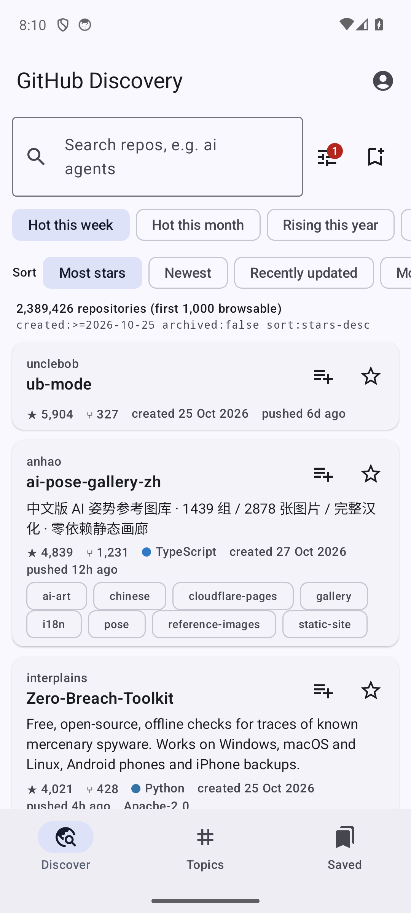
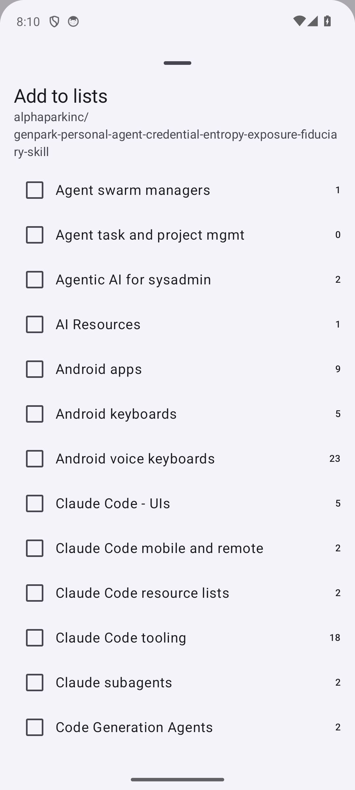

# GitHub Discovery

An Android app for one job: **finding GitHub repositories and starring them into Lists.** It gives you the desktop advanced-search operators on mobile, browsing by topic, "trending"-style views, and Star Lists. It deliberately does nothing else: no code, issues, PRs or editing.

<p>


</p>

## Features

- **Advanced search as a form.** Keywords with `in:name/description/readme/topics`, topics, language, owner, stars and forks ranges, created and last-pushed windows, license, good-first-issues, archived and fork toggles, plus a free-text field for any other qualifier (`size:`, `followers:`, `NOT …`). The exact query string is shown, so you can select it and copy it.
- **Trending stand-ins:** Hot this week, Hot this month, Rising this year (most-starred repos created in that window), Newest, Most starred ever, Active now.
- **Sorts:** Most stars, Newest, Recently updated, Most forks, Best match, Help wanted.
- **A Newest feed with no 1,000-result cap.** GitHub search can't sort by creation date, so the app walks backwards through `created:` date windows. Other sorts stop at GitHub's 1,000-results-per-query limit.
- **Topics:** featured topics, topic search, and quick-pick chips. Tap any topic on a repo card to search that topic.
- **Star and Star Lists:** star or unstar with one tap. Add a repo to any of your Lists, or create a new public or private list, from the sheet.
- **Saved searches**, stored on the device.
- Tap a card to open the repo in a Chrome Custom Tab.

## Sign-in

GitHub OAuth **Device Flow**: the app shows a code, and you approve it at github.com/login/device with your own account. The token is stored only on your device. There is no server and no client secret, so anyone can install the app and use their own account.

Requested scope: `public_repo`, which starring needs.

## Install

Download `app-release.apk` from [Releases](https://github.com/danielrosehill/GitHub-Discovery/releases) and sideload it. It is signed with the standard debug key, so a rebuild from source installs over it.

## Build

```bash
export JAVA_HOME=/usr/lib/jvm/java-21-openjdk-amd64   # JDK 17+; AGP 8.13 does not run on JDK 25
./gradlew assembleRelease                              # app/build/outputs/apk/release/app-release.apk
```

Stack: Kotlin 2.2.20, Jetpack Compose (BOM 2025.09.01), Material 3, OkHttp, GitHub GraphQL API (REST only for topic search). minSdk 26, targetSdk 36.

## License

MIT
